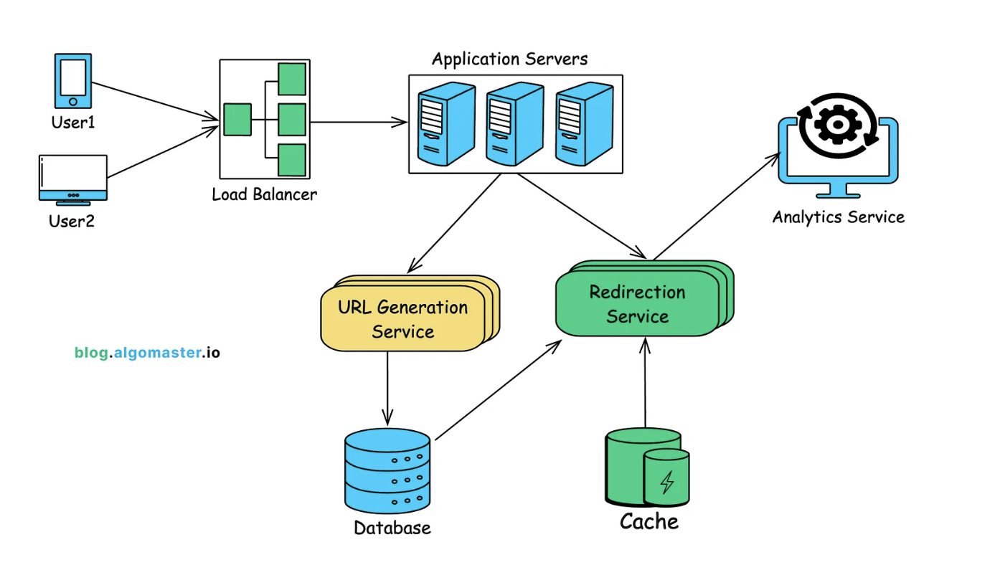

Here is some concepts about system design of url shorterner link

# 1. Design

Link: [https://blog.algomaster.io/p/65a5faf2-ccb7-4734-b9fc-f26dbf6aed46](https://blog.algomaster.io/p/65a5faf2-ccb7-4734-b9fc-f26dbf6aed46)

# 2. Notes

## Sharding

Implement sharding to distribute data across multiple database nodes.

- **Range-Based Sharding:** If you are using an auto-incrementing ID as the shard key, the first shard might store IDs 1 to 1,000,000, the second shard 1,000,001 to 2,000,000, and so on.

  - Limitations: If your data isn’t evenly distributed, one shard may become much larger than others, leading to uneven load distribution (known as a "hotspot").

- **Hash-Based Sharding:** It involves applying a hash function to the shard key to determine which shard the data should go to. For example, you might hash the short URL identifier and then take the modulo with the number of shards to determine the shard (e.g., hash(short_url) % N where N is the number of shards).

  - Limitations: When scaling out (adding new shards), re-hashing and redistributing data can be challenging and requires consistent hashing techniques to minimize data movement when adding or removing shards.

## Solution: Consistent Hashing

**🎯 Goal:** Avoid massive data movement when scaling up/down.

**🧠 The Concept:**
Think of a circular ring (like a clock).

You hash both keys (like user_id) and shards into this ring.

**Example:**

[HASH RING] → 0 → A → B → C → 360°
↑ ↑
hash(user_id)

- A key is assigned to the next node clockwise.

- If you add or remove a shard, only the keys near that node are affected — others stay put.

**📈 Benefits Under Peak Traffic**

- Load is still spread evenly (like regular hashing).

Scaling under load becomes safe:

- Add a new shard? Only ~1/N of keys shift to it.

- Remove a shard? Its keys redistribute minimally.

- No central coordination needed — each request hashes locally and routes correctly.

**🔄 Example:**

You have 3 shards: A, B, C

- Hash ring:

A = hash("A") = 45°

B = hash("B") = 120°

C = hash("C") = 270°

user_id 1234 → hash = 130° → Goes to C

- Add new shard D at 150°

Now user_id 1234 goes to D

But keys at 0–120°, 270°+ → remain with A, B, C

### Question: When to add shard D => user_id = 1234 will go shard D and do not have data, do it make a duplicate data in both shard C and D ?

**✅ Solution: Rebalancing After Adding a Shard**

- When a new shard is added:

- You must move the appropriate data from old shards to the new shard.

- In this case, Shard C → Shard D for the affected hash range.

**This step is called resharding or rebalancing.**

**📦 Think of it like migrating a small portion of the dataset:**

- Only the data that now maps to the new shard’s range (e.g., keys between 130° and 135°).

- Not the whole dataset — just a slice.
