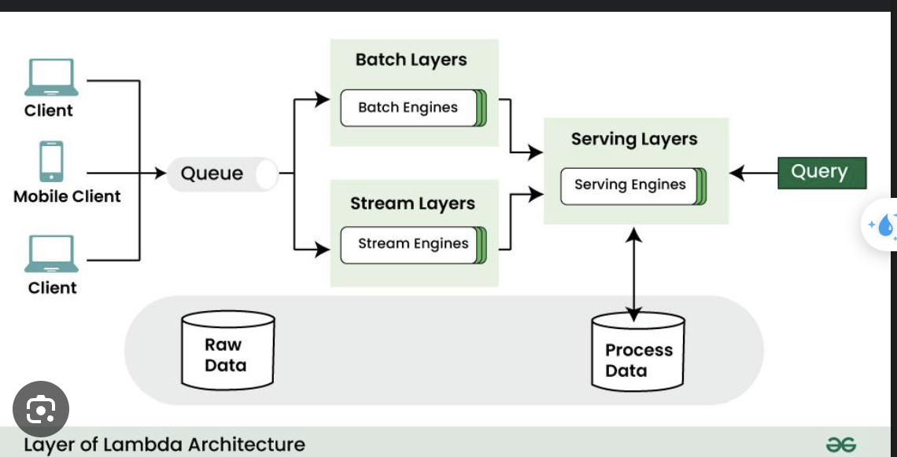
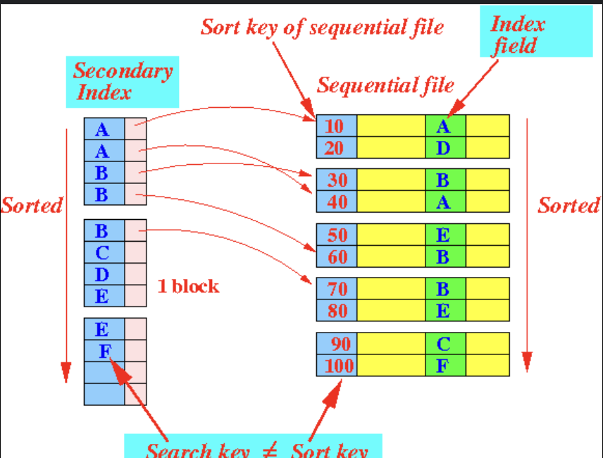

# 1. REST, GraphQL, gRPC

## 1.1. REST

1. **What it is:**

- Architectural style using HTTP with resources identified by URLs and standard verbs (GET, POST, PUT, DELETE).

2. **Use case:**

- Exposing APIs for CRUD operations (e.g., e-commerce product APIs).

3. **Pros:**

- Simple, widely adopted, easy to use.

- Human-readable (JSON/HTTP).

4. **Cons:**

- Over-fetching or under-fetching data.

## 1.2. GraphQL

1. **What it is:**

- Query language for APIs where clients specify exactly what data they need.

2. **Use case:**

- Mobile apps needing flexible and efficient data fetching.

3. **Pros:**

- No over-fetching/under-fetching.

- Strongly typed schema.

- Single endpoint for all queries.

4. **Cons:**

- Complex: Implement in both backend and frontend.

```javascript
// Backend
 type Query {
  user(id: ID!): User
  posts: [Post]
}


// Frontend
const { data } = useQuery(gql`
  query {
    user(id: "123") {
      name
      email
    }
  }
`);
```

- Caching becomes hard: Use only 1 endpoint /graphql to query.

- Versioning is ambiguous: same endpoint but different query.

- N+1 problem: Query list first, and each member later.

## 1.3. gRPC

1. **What it is:**

- High-performance, contract-first RPC framework using Protocol Buffers over HTTP/2.

2. **Use case:**

- Microservices communicating in low-latency, high-throughput systems.

3. **Pros:**

- Fast and efficient (binary, HTTP/2 streaming).

- Strongly typed contracts via Protobuf.

- Supports bi-directional streaming.

4. **Cons:**

- Harder debugging (binary vs JSON) => And it has gRPC web extension

- Less human-friendly than REST/GraphQL.

# 2. Long polling, WebSockets, Server-Sent Events (SSE)

## 2.1. Long Polling and Short Polling

1. **What it is:**

- Short polling → client keeps asking at fixed intervals, server always responds immediately.

- Long polling → client asks, server holds connection open until new data is ready.

2. **Use case:**

Legacy systems simulating real-time chat.

3. **Pros:**

- Easy to implement (works with HTTP/1.1).

- Broad browser support.

- Works behind firewalls/proxies.

4. **Cons:**

- High overhead (many requests).

- Latency between events.

- Not scalable for many clients.

## 2.2. WebSockets - Stateful

1. **What it is:**

- Full-duplex communication channel over a single TCP connection.

2. **Use case:**

- Real-time apps (chat, multiplayer games, trading platforms).

3. **Pros:**

- True real-time, low latency.

- Bi-directional.

- Efficient (single persistent connection) => Use WebSocket protocol.

4. **Cons:**

- More complex to scale/load-balance (sticky session).

- Older browsers don't support WebSockets (becoming less relevant): Internet Explorer, Old Edge.

## 2.3. Server-Sent Events (SSE) - Stateless

1. **What it is:**

- One-way streaming from server to client over HTTP.

2. **Use case:**

- Live news feeds, stock tickers, notifications.

3. **Pros:**

- Keep only 1 connection from client to server.

- Efficient for one-way events.

4. **Cons:**

- One-directional (server → client only).

- Not binary, only text.

- Limited browser support.

# 3. Event-Driven Architecture

1. **What it is:**

- System design where services communicate via events

2. **Use case:**

- E-commerce order system

3. **Pros:**

- Loosely coupled, scalable.

- Asynchronous and resilient.

- Easy to extend with new consumers.

4. **Cons:**

- Hard to debug event chains.

- Event ordering can be tricky.

- Higher operational complexity (brokers, retries).

# 4. Microservice

1. **Pros:**

- Independent scaling and deployments.

- Tech flexibility (different stacks per service).

- Fault isolation (one service down ≠ whole system).

2. **Cons:**

- Complex networking & communication.

- Harder testing/debugging end-to-end.

- Requires DevOps maturity (CI/CD, monitoring).

# 5. Monolithics

1. **Pros:**

- Simpler to build, test, deploy.

- Easy debugging (single codebase).

- Less operational overhead.

2. **Cons:**

- Hard to scale specific parts.

- Need to vertical scaling but have limit (Amdahl’s Law)

- Deployment the whole app.

# 6. EBS Architecture

1. **Use cases:**

- Large enterprises integrating legacy systems.

2. **Pros:**

- Reusable services across organization.

- Centralized governance.

- Good for heterogeneous tech stacks.

3. **Cons:**

- ESB can be a bottleneck (single point of failure).

# 7. SOA Architecture

1. **Pros:**

- Simpler data consistency: one source of truth, no distributed transactions.

- Lower infrastructure cost: no need to maintain multiple DBs.

2. **Cons:**

- Bottlenecks database.

- Reduced the scale with same DB.

- Tight coupling in schema with multiple service.

# 8. Sagas

1. Use cases:

- Booking system (reserve hotel → flight → car; rollback if one fails).

2. **Pros:**

- Enables consistency without distributed locks.

- Scales across microservices.

- Failure recovery via compensating transactions.

3. **Cons:**

- Need to handle fallback in workflow state machine.

- Hard to test or fallback all failure paths.

# 9. Publish-Subscribe

1. Use cases

You said:
Thundering Herd
ChatGPT said:

"Thundering Herd" có nhiều nghĩa tùy ngữ cảnh, nhưng trong kỹ thuật hệ thống/phần mềm thì thường chỉ một vấn đề về tài nguyên đồng thời:

1. Trong Computer Science / System Design

Thundering Herd Problem xảy ra khi có nhiều process hoặc thread cùng lúc bị “đánh thức” để xử lý một sự kiện, nhưng chỉ có một trong số đó thực sự làm việc, còn những cái khác thì lãng phí CPU, I/O.

Ví dụ:

Nhiều worker thread cùng chờ dữ liệu từ socket.

Khi socket có dữ liệu, hệ điều hành đánh thức tất cả các thread, nhưng chỉ một thread thực sự đọc được.

Các thread còn lại bị “thất vọng” (wake up nhưng không làm gì được) → gây overhead, context switch thừa, và giảm hiệu năng.

👉 Đây là lý do tại sao epoll (Linux) hoặc IOCP (Windows) hiệu quả hơn so với select/poll, vì chúng tránh thundering herd bằng cách chỉ đánh thức một worker thực sự có thể xử lý.

2. Trong Distributed Systems / Caching

Thundering Herd cũng dùng để chỉ tình huống nhiều client cùng lúc truy cập một key vừa hết hạn trong cache.

Tất cả request cùng đổ dồn về database hoặc backend để tính toán lại giá trị đó → gây quá tải.

Giải pháp:

Cache stampede protection: dùng lock, random TTL, hoặc “early refresh”.

Request coalescing: gom nhiều request thành một, rồi broadcast kết quả.

3. Ngoài ngành kỹ thuật

"Thundering Herd" còn là biệt danh của Marshall University (đội thể thao ở Mỹ).

Trong ngữ cảnh đời thường: nghĩa đen là “đàn trâu/voi ầm ầm chạy tới”.

👉 Bạn muốn mình giải thích sâu hơn theo hướng hệ điều hành, cache/distributed systems, hay chỉ cần khái niệm chung chung thôi?

You said:
use cases of the circuilt breaker
ChatGPT said:

Good question 👍

The Circuit Breaker pattern is widely used in distributed systems and microservices to handle failures gracefully. Instead of endlessly retrying and making a bad situation worse, it stops calls to an unhealthy service until it recovers.

Here are the main use cases:

🔹 1. Unstable or Slow Downstream Services

When a service you depend on (database, API, payment gateway, third-party service) becomes slow or unresponsive.

Without a circuit breaker → your service keeps sending requests → threads get blocked, queues fill up, users face timeouts.

With circuit breaker → requests quickly fail or return fallback responses instead of hanging.

🔹 2. External API Integration

Example: Payment gateways, SMS/email providers, OAuth servers.

If the external API is down or rate-limited, you don’t want your system to crash under retry storms.

Circuit breaker ensures you degrade gracefully (e.g., “Payment service temporarily unavailable, try again later”).

🔹 3. Protecting Shared Resources

Suppose multiple microservices call the same database.

If the database slows down, all microservices will flood it with retries → worsening the bottleneck (thundering herd problem).

Circuit breaker prevents overloading by short-circuiting requests and failing fast.

🔹 4. Preventing Cascading Failures

In a microservices chain, one service depends on another, which depends on another…

If one downstream fails, the failure can cascade up the chain.

Circuit breaker localizes the failure (like a fuse in electricity), preventing the whole system from collapsing.

🔹 5. Retry Storm Mitigation

When multiple clients retry aggressively after a failure, it can overload the system.

Circuit breaker avoids this by opening and rejecting requests for a cooldown period.

🔹 6. User Experience Degradation Control

Instead of giving users endless loading spinners/timeouts, circuit breaker returns fallbacks:

Show cached/stale data.

Return a default value.

Gracefully degrade non-critical features.

🔹 7. Rate Limiting and Quota Enforcement

Sometimes combined with bulkhead pattern:

Circuit breaker opens if too many requests fail or time out.

This protects upstream systems from traffic spikes.

✅ Example in practice:

Netflix OSS Hystrix (Java) → classic circuit breaker library.

Resilience4j (modern Java).

Polly (.NET).

Envoy/Istio service mesh implements circuit breakers at the network layer.

👉 Do you want me to also draw a state diagram (Closed → Open → Half-Open) with explanation, so you can see how it actually works step by step?

You said:
real world use case
ChatGPT said:

Got it 👍 You want a real-world case, not just the theory. Let’s walk through a few concrete ones:

🏦 Bank Payment System

Imagine you run an e-commerce platform.

At checkout, your system calls a third-party payment gateway (like Visa/Mastercard API).

Suddenly, the gateway is down.

Without a circuit breaker → every checkout request hangs until timeout, threads pile up, and your service crashes.

With a circuit breaker → after a few failures:

The breaker opens, and you stop calling the gateway.

Users instantly get: “Payment system temporarily unavailable, please try again later.”

Your platform stays up, even if the payment provider is down.

📱 Ride-Hailing App (Uber/Grab)

The trip-matching service depends on maps + distance calculation APIs.

If Google Maps API becomes slow:

Without breaker → every ride request gets delayed, riders can’t book trips.

With breaker → fallback logic kicks in (e.g., estimate distance using cached routes), so users still see approximate ETAs.

This avoids cascading failures across all ride bookings.

🎥 Netflix / Streaming Service

Netflix depends on dozens of microservices: recommendations, search, playback, billing, etc.

Suppose the recommendation service goes down.

Without breaker → video playback service also gets stuck waiting for recommendations.

With breaker → Netflix serves fallback recommendations (“Top Picks”, cached lists) and video still plays smoothly.

Result: Users don’t notice a full outage, only minor degraded features.

🛒 E-commerce Inventory

Your checkout service calls the inventory microservice.

If inventory is under heavy load during Black Friday:

Circuit breaker opens after failures.

Checkout service instantly falls back: “Unable to verify stock right now — try again in a few minutes.”

System avoids total crash from retry storms.

👉 In short:

Without circuit breaker → failure in one service can crash your whole system.

With circuit breaker → you localize failure, degrade gracefully, and keep the core system alive.

Do you want me to pick one of these (say, e-commerce checkout + payment gateway) and show you how the breaker states (closed → open → half-open) actually play out step by step in that real case?

You said:
when to use OAuth2
ChatGPT said:

Great question 👍 — OAuth2 is one of those things that people often hear about but aren’t sure exactly when to use.

Here’s a breakdown:

✅ When to Use OAuth2

1. Third-Party Application Access

You want a user to let a third-party app access their data without sharing their password.

Example:

You log into a fitness app and let it pull your step data from your Google Fit account.

You don’t give the fitness app your Google username/password. Instead, you approve it via OAuth2.

2. Single Sign-On (SSO)

Letting users log into your app using another identity provider (Google, Facebook, GitHub, Apple, etc.).

Example:

“Log in with Google” button on a website.

Under the hood → OAuth2 authorization code flow is used.

3. Access Delegation Between Services

In a microservices or API ecosystem, one service needs to call another on behalf of a user.

Example:

A travel booking service (frontend) needs to call both the airline API and hotel API with the user’s permissions.

OAuth2 ensures tokens carry the right scope for each call.

4. Mobile and Native Apps

You don’t want to store or handle user passwords inside the app.

Instead, the app uses OAuth2 flows (PKCE for mobile) to get tokens.

Example:

Spotify mobile app uses OAuth2 PKCE flow to connect with your Google or Facebook account.

5. API Gateways and Resource Servers

If you expose APIs to external clients, you want to protect them with tokens instead of raw credentials.

Example:

A payment API where each client app must present a Bearer Token (OAuth2 access token) to prove identity.

6. Granular Permission Control (Scopes)

When different apps/users should only access part of the data.

Example:

A calendar app requests only "calendar.readonly" scope from Google API.

OAuth2 lets the user grant only that access.

🚫 When Not to Use OAuth2

If your system is internal only (e.g., just employees, no third-party apps) → SAML, LDAP, or plain JWT might be simpler.

If you only need simple login for a website with no API delegation → traditional session-based login may be enough.

If clients are fully trusted (like backend-to-backend communication in the same company) → mutual TLS or API keys might suffice.

🔑 In short:

Use OAuth2 when you need secure delegated access, especially if:

Third-party apps are involved.

You want to avoid sharing passwords.

You need fine-grained access control with scopes.

You’re building APIs for external or mobile clients.

👉 Do you want me to also compare OAuth2 vs JWT (since a lot of people get confused between them) so you can see when to pick which?

You said:
OpenID Connect (OIDC)
ChatGPT said:

Perfect follow-up 👌 — OpenID Connect (OIDC) often comes up right after OAuth2 because they’re related but solve slightly different problems.

🔑 What is OIDC?

OpenID Connect is an identity layer built on top of OAuth2.

OAuth2 by itself is for authorization (granting access to resources).

OIDC adds authentication (proving who the user is).

So:

OAuth2 → “App X can access this data on behalf of the user.”

OIDC → “This is who the user is (and here’s their profile info).”

🛠 How It Works

OIDC adds a special token called an ID Token (a JWT) that contains information about the authenticated user:

sub → unique user ID

name, email, picture → profile claims

iss (issuer), aud (audience), exp (expiration)

So an app not only gets an access token (to call APIs) but also an ID token (to identify the user).

✅ Use Cases of OIDC

1. Single Sign-On (SSO)

One login works across many apps.

Example:

Use your Google account to log into YouTube, Gmail, Drive, etc.

OIDC provides a standard way for apps to trust Google as the identity provider.

2. “Login with …” Buttons

Websites offering “Login with Google / Facebook / Apple / GitHub” use OIDC behind the scenes.

OAuth2 alone can’t tell you who the user is — it only gives access to APIs. OIDC solves that.

3. Enterprise Authentication

Large companies using identity providers (e.g., Okta, Auth0, Keycloak, Azure AD).

Employees log in once, then OIDC tokens are used across internal apps.

4. Mobile & SPA Authentication

For mobile apps or single-page apps (React/Angular/Vue) where you don’t want to handle passwords directly.

The app redirects to the IdP (e.g., Google), user signs in, and the app gets back ID + Access Tokens.

5. API Security with User Context

Suppose you build an API gateway.

Access tokens (OAuth2) prove a client can access the API.

ID tokens (OIDC) tell the API which user is behind the request.

🔄 OAuth2 vs OIDC in One Line

OAuth2 → Authorization (what an app can do).

OIDC → Authentication (who the user is).

✅ Real example:
When you log in to Spotify with Google:

OAuth2 gives Spotify a token to access your Google APIs (if you grant).

OIDC gives Spotify your Google identity info (your name, email, profile pic).

👉 Do you want me to also show you a flow diagram (Authorization Code Flow with OIDC) so you see how ID token + access token are issued together?

You said:
what is special than pure OAuth2
ChatGPT said:

Great question 🙌 — this is the exact reason why OIDC was created, because pure OAuth2 wasn’t enough for authentication.

🔎 What makes OIDC “special” compared to pure OAuth2?

1. Authentication vs. Authorization

OAuth2 was designed for authorization (granting access to resources).

Example: “Allow App X to access your Google Drive files.”

OIDC adds authentication (verifying who the user is).

Example: “This is John Doe, logged in via Google.”

👉 Pure OAuth2 can’t reliably tell you who the user is, only that the app has permission to act.

2. ID Token (JWT)

OIDC introduces a new token type: the ID Token.

Contains identity information about the user (sub, email, name, etc.).

Signed by the Identity Provider (IdP) → the app can trust it.

OAuth2 only gives you access tokens (no user identity guaranteed).

3. Standardized User Info Endpoint

OIDC defines a UserInfo endpoint where apps can fetch consistent profile data.

Example: https://accounts.google.com/userinfo → returns JSON with user’s email, name, picture.

OAuth2 leaves user identity API undefined, so every provider does it differently.

4. Discovery & Metadata

OIDC defines a discovery document (/.well-known/openid-configuration).

Apps can automatically find:

Authorization endpoints

Token endpoints

Supported scopes

Public keys for verifying ID tokens

OAuth2 has no such standardized discovery.

5. Scopes for Identity

OIDC defines special scopes like:

openid (required for OIDC)

profile (name, picture, etc.)

email

OAuth2 scopes are arbitrary and provider-specific.

6. Stronger Security Flows

OIDC mandates Authorization Code Flow with PKCE for modern apps (esp. SPAs & mobile).

This closes gaps in OAuth2 where misuse could leak tokens.

🔑 In short:

OAuth2 only → “This app can access resource X.”

OIDC (on top of OAuth2) → “This is user Y, authenticated by Z, and here’s a secure token to prove it.”

✅ Real-world example:

If you use “Log in with Google”:

OAuth2 alone would only give the app access to your Gmail/Drive.

OIDC provides your Google identity (name, email, profile pic) so the app can actually log you in.

👉 Do you want me to create a side-by-side table (OAuth2 vs OIDC) so it’s crystal clear what OIDC adds on top?

You said:
do oidc and oauth2 in the same provider of google
ChatGPT said:

Yes ✅ — Google (and most modern providers) support both OAuth2 and OIDC on the same platform.

🔹 How Google does it

OAuth2:

Used when you just need an access token to call Google APIs (e.g., Gmail, Drive, Calendar).

Example: A file-sharing app requests access to your Google Drive.

You get an access token scoped to drive.readonly.

OIDC:

Used when you need to authenticate the user (log in with Google).

You include the openid scope in your request.

Google then returns not only an access token but also an ID token (JWT) that contains the user’s identity (sub, email, name, etc.).

👉 In practice:

Same Google authorization endpoint (https://accounts.google.com/o/oauth2/v2/auth).

Same Google token endpoint (https://oauth2.googleapis.com/token).

If you add the openid scope, the flow becomes OIDC-compliant.

🔹 Example Scenarios

Using OAuth2 only

You want to access Google Calendar API.

Request scope: https://www.googleapis.com/auth/calendar.readonly.

You get an access token.

You can call https://www.googleapis.com/calendar/v3/... with that token.

Using OIDC (OAuth2 + openid)

You want to let users “Sign in with Google.”

Request scopes: openid email profile.

You get:

An ID token (JWT) → tells you the user’s identity.

(Optionally) an access token if you also need to call Google APIs.

🔑 Key Point

Same provider (Google).

Same endpoints.

The difference is in the scopes you request:

No openid → pure OAuth2 (authorization).

With openid → OIDC (authentication + authorization if needed).

👉 Do you want me to show you a sample Google OAuth2/OIDC request + decoded ID token so you can see exactly how the data differs?

You said:
what is openID
ChatGPT said:

Great question 👍 — because OpenID and OpenID Connect (OIDC) sound similar, but they’re not the same thing.

🔹 OpenID (the original one)

OpenID (created ~2005) was an authentication protocol for the web.

Goal: “One account, many sites” — users could log in to different websites without creating new accounts everywhere.

It worked like this:

You had an OpenID identifier (like a URL).

When you logged in to a site, it redirected you to your OpenID provider (Yahoo, MyOpenID, etc.) to authenticate.

The provider told the website: “Yes, this person owns https://alice.myopenid.com/.”

It was decentralized: anyone could run an OpenID provider.

Problem: it was complicated, hard for developers, weak UX → adoption failed.

🔹 OpenID Connect (OIDC)

Introduced later (~2014) as the modern replacement for OpenID.

Built on top of OAuth2 → simpler, more secure, and developer-friendly.

Today, when you see “Sign in with Google / Microsoft / Facebook”, that’s usually OIDC, not the old OpenID.

Unlike old OpenID, OIDC is widely adopted (Google, Microsoft, Apple, Okta, etc.).

🔑 Difference in One Line

OpenID (old) → legacy authentication protocol, now obsolete.

OpenID Connect (OIDC) → modern identity layer built on OAuth2, widely used for login and SSO today.

✅ Example:

If you logged in to a website in 2008 with OpenID → you’d type your OpenID URL like alice.myopenid.com.

If you log in today with Google using OIDC → you just click “Sign in with Google”, and behind the scenes, OIDC provides your identity in an ID Token.

👉 Do you want me to also make a timeline (OpenID → OAuth2 → OIDC) so you can see how these evolved into what we use now?

You said:
openID provider
ChatGPT said:

Nice — now we’re talking about OpenID Provider (OP), which is a key term in OpenID (and OpenID Connect).

🔹 What is an OpenID Provider (OP)?

An OpenID Provider is the identity service that authenticates the user and issues tokens (ID Token, Access Token).

It’s basically the authority you trust to prove a user’s identity.

In OIDC language:

OP = the server that handles login (the Identity Provider, IdP).

Relying Party (RP) = the app/website that trusts the OP for authentication.

🔹 Real-world Examples of OpenID Providers

All of these are OPs because they support OIDC:

Google → accounts.google.com

Microsoft Azure AD / Entra ID → login.microsoftonline.com

Apple → Sign in with Apple

Auth0 (Identity-as-a-Service)

Okta

Keycloak (open-source)

Amazon Cognito

🔹 How It Works (Simple Flow)

User clicks “Login with Google”.

Your app (Relying Party) redirects the user to the OP (Google).

The OP authenticates the user (password, MFA, biometrics, etc.).

OP issues:

ID Token → proves identity (JWT).

Access Token → optional, for APIs.

Your app validates the tokens and logs the user in.

🔹 Example: Google as OP

Discovery document:

https://accounts.google.com/.well-known/openid-configuration

This JSON tells your app:

Where to send users for login (authorization_endpoint)

Where to exchange tokens (token_endpoint)

What keys to use to verify ID Tokens (jwks_uri)

✅ In short:
An OpenID Provider (OP) is the identity server that performs authentication and issues identity tokens. Your app (RP) relies on the OP instead of handling user credentials itself.

👉 Do you want me to also show you a concrete example with Google OP (request URL + sample ID token payload) so you can see what the OP actually gives back?

You said:
oauth means oauth + openID ?
ChatGPT said:

Almost, but not quite 🙂 Let’s clear this up because people often mix these terms.

🔹 OAuth vs OpenID Connect

OAuth2

A framework for authorization.

Lets an app get access tokens to call APIs on behalf of a user.

Example: A calendar app gets an access token to read your Google Calendar.

OpenID Connect (OIDC)

An identity layer built on top of OAuth2.

Uses the same flows and endpoints as OAuth2, but adds:

ID Token (JWT) → tells you who the user is.

UserInfo endpoint → standardized way to fetch user profile.

Example: A website logs you in with Google and gets your email + name.

🔑 So, does “OAuth” mean “OAuth + OpenID”?

❌ No → OAuth2 by itself does not include OpenID.

✅ But → OpenID Connect uses OAuth2 underneath.

When you request the openid scope in OAuth2 → you are effectively upgrading the flow to OIDC.

🔹 Think of it like this:

OAuth2 = building blocks (tokens, scopes, consent).

OIDC = OAuth2 + identity features (ID Token, standardized login).

So:

If you only want API access → OAuth2 is enough.

If you want login / authentication → you need OAuth2 + OIDC.

✅ Example with Google:

If you request scope https://www.googleapis.com/auth/calendar.readonly → you’re using OAuth2 only (just access token).

If you request scope openid email profile → you’re using OAuth2 + OIDC (access token + ID token).

👉 Do you want me to make a diagram showing OAuth2 vs OIDC tokens so you can see exactly what extra you get when adding OpenID?

You said:
SSO and openID connect different
ChatGPT said:

Yes 👍 they’re related but not the same thing — people often confuse them.

🔹 Single Sign-On (SSO)

Concept / goal: One login, many apps.

User signs in once → can access multiple applications without re-entering credentials.

Not a protocol → it’s an experience.

Different technologies can provide SSO:

OIDC (modern web/mobile apps).

SAML (common in enterprises).

Kerberos (Windows/AD environments).

CAS, Shibboleth, etc.

Example:

You log in once to your company’s portal.

Then you can access email, HR system, and project tools without logging in again.

🔹 OpenID Connect (OIDC)

Protocol / standard built on top of OAuth2.

Provides authentication (ID Token) + user identity info.

One of the most common technologies used to implement SSO, especially in modern apps.

Example:

"Login with Google" → that’s OIDC.

Your app trusts Google as the identity provider (OpenID Provider).

Once authenticated, you can use the same Google session to log in to other apps without retyping your password → that’s SSO powered by OIDC.

🔑 Difference in One Line

SSO = the experience of logging in once and reusing it.

OIDC = a protocol that can be used to implement that experience.

✅ Analogy:

SSO = the concept of “public transportation” (move once, access multiple stops).

OIDC = one type of bus/train system that makes public transportation possible.

👉 Do you want me to also compare OIDC vs SAML (since both are used for SSO but in different contexts: cloud vs enterprise)?

You said:
i mean OIDC and SAML use to implement SSO ?
ChatGPT said:

Exactly ✅ — you’ve got it. Both OIDC and SAML are protocols/standards that are commonly used to implement Single Sign-On (SSO).

🔹 How They Fit Together

SSO = the concept/experience → log in once, access many apps.

OIDC and SAML = technologies (protocols) that make SSO possible.

So when people say “We use SSO with Google” or “We use SSO with Okta,” under the hood it’s often OIDC or SAML doing the work.

🔹 OIDC vs SAML for SSO
Feature OIDC SAML
Based on OAuth2 (JSON, REST, JWT) XML
Purpose Modern web/mobile login & API auth Enterprise SSO (legacy web apps, intranet)
Token type ID Token (JWT) + Access Token SAML Assertion (XML doc)
Data format JSON (lightweight) XML (verbose)
Common usage Cloud apps, mobile, APIs, “Login with Google/Facebook” Corporate environments, federated identity (ADFS, enterprise portals)
Developer friendliness Easy (JSON, REST APIs) Harder (XML, SOAP)
Examples Login with Google, Microsoft, Apple, Auth0 Logging into corporate apps via Okta, Azure AD, ADFS
🔹 Real-World Examples

OIDC SSO:

You log into Slack or Zoom using “Sign in with Google/Microsoft”.

The app uses OIDC to get your ID Token from Google.

SAML SSO:

You log into your company’s HR portal (Workday, SAP) with your corporate account.

The portal and your company’s Active Directory Federation Services (ADFS) exchange SAML assertions.

🔑 In short:

SSO = the experience.

OIDC and SAML = two different protocols that implement SSO.

Trend:

Newer apps → OIDC.

Legacy/enterprise apps → SAML.

👉 Do you want me to make a timeline showing how SAML (2005) → OAuth2 (2012) → OIDC (2014) evolved as technologies for SSO?

You said:
get use case login with google based on Resource Server: Merchant application, or the server that client requests to.

- Authorization Server: the server receive client + requests access from resource server => create access token.

- Resource Owner: tool to grant resources for oauth token.

- Scopes: the scope that resource owner grant.

- Access token: gen from scopes and client.
  ChatGPT said:

Perfect 👍 — let’s map “Login with Google” to the OAuth2/OIDC roles you listed. I’ll use an example where a Merchant Application (your app) lets users log in with Google.

🏗 Actors in the Flow

Resource Owner → the end-user (you).

Owns the data (Google identity, email, profile).

Grants consent to share it with the Merchant App.

Client → the Merchant Application (your website/app).

Wants to let users “Log in with Google.”

Needs an ID Token (for login) and maybe Access Token (to call Google APIs).

Authorization Server → Google Accounts server.

Endpoint: https://accounts.google.com/o/oauth2/v2/auth

Authenticates the user (with password, MFA, etc.).

Issues ID Token (for authentication) + Access Token (for APIs).

Resource Server → Google UserInfo API (and other Google APIs).

Endpoint: https://openidconnect.googleapis.com/v1/userinfo

Returns user profile (name, email, picture).

Protected by the Access Token.

Scopes → what the Merchant App is asking for.

Example:

openid (mandatory for OIDC → ID Token)

email (get user’s email)

profile (name, picture)

Access Token → short-lived token issued by Google.

Used by Merchant App to call the Resource Server (e.g., fetch /userinfo).

ID Token → (special OIDC piece) JWT containing user identity.

Example payload:

{
"sub": "1234567890",
"name": "Alice Example",
"email": "alice@gmail.com",
"iss": "https://accounts.google.com",
"aud": "merchant-app-client-id",
"exp": 1694059200
}

🔄 Flow in “Login with Google”

User (Resource Owner) clicks “Login with Google” in Merchant App (Client).

Client redirects user to Google Authorization Server with request:

GET https://accounts.google.com/o/oauth2/v2/auth
?client_id=merchant-app-client-id
&redirect_uri=https://merchant.com/callback
&scope=openid email profile
&response_type=code

Authorization Server (Google) shows a consent screen →
“Allow Merchant App to access your profile and email?”

If approved → issues an Authorization Code.

Client exchanges the code at Google Token Endpoint →
Gets back ID Token + Access Token.

Merchant App (Client) validates the ID Token → logs the user in.

If needed, Merchant App uses the Access Token to call Google Resource Server /userinfo → fetch name/email/picture.

✅ Mapping to Your Terms

Resource Server → Google APIs (/userinfo)

Authorization Server → Google OAuth2/OIDC server (accounts.google.com)

Resource Owner → The user (owns their Google profile data)

Scopes → openid email profile

Access Token → issued by Google, used by Merchant App to call Google Resource Server

👉 Would you like me to also draw a sequence diagram (step-by-step arrows between User, Merchant App, Google Auth Server, Google Resource Server) so you can visualize this flow?

You said:
hashing encryption
ChatGPT said:

Good one 👍 — people often mix up hashing and encryption, but they’re different tools for different purposes.

🔹 Hashing

One-way function → you can’t get the original data back.

Used for integrity and verification.

Output: fixed-length “fingerprint” of input data.

Same input → always the same hash.

Slight change in input → totally different hash.

Examples:

SHA-256, MD5 (old), SHA-3, BLAKE2.

Use cases:

Password storage (store only hash, not plain password).

File integrity check (compare hash before/after download).

Digital signatures.

Analogy: → like turning an egg into an omelet 🥚🍳 — you can’t get the egg back.

🔹 Encryption

Two-way function → you can encrypt (lock) and decrypt (unlock).

Used for confidentiality (keeping data secret).

Needs a key.

Two types:

Symmetric encryption (same key for encrypt + decrypt) → AES, DES.

Asymmetric encryption (public/private key pair) → RSA, ECC.

Use cases:

Sending private messages.

Protecting data in databases or files.

Secure web communication (HTTPS/TLS).

Analogy: → like locking something in a safe 🔒 — with the right key, you can unlock it.

🔑 Quick Comparison
Feature Hashing Encryption
Direction One-way Two-way
Purpose Integrity, verification Confidentiality
Key required? No Yes
Output Fixed-length digest Encrypted ciphertext
Example SHA-256("hello") → 2cf24dba... AES("hello", key) → E9FA1234...

✅ In short:

Use hashing when you want to verify data but don’t need the original (passwords, file integrity).

Use encryption when you want to protect data and be able to get it back (messages, files, databases).

👉 Do you want me to also explain where hashing + encryption work together (e.g., digital signatures, HTTPS)?

You said:
explain the algorithm of this
ChatGPT said:

Got it 👍 — let’s break down the algorithms for hashing and encryption separately, step by step.

🔹 1. Hashing Algorithm (e.g., SHA-256)
Goal:

Turn input → fixed-length digest, in a one-way manner.

Steps (simplified for SHA-256):

Input message:

"hello"

Preprocessing:

Convert to binary.

Pad the message so its length is a multiple of 512 bits.

Append message length at the end.

Initialize hash values:

SHA-256 uses 8 fixed constants (h0–h7).

Process in blocks (512 bits each):

Break input into chunks.

Use a compression function with bitwise operations (AND, OR, XOR, shifts).

Mix with constants (64 of them, derived from prime numbers).

Iterate rounds (64 rounds per block):

Each round scrambles data more, ensuring small changes → big difference in output.

Final output (digest):

After all rounds, combine h0–h7 into a 256-bit hash.

Represent as 64 hex characters.

✅ Example:

SHA-256("hello")
= 2cf24dba5fb0a30e26e83b2ac5b9e29e1b161e5c1fa7425e73043362938b9824

👉 Key property: irreversible, deterministic, collision-resistant.

🔹 2. Encryption Algorithm

There are two main types — let’s cover AES (symmetric) and RSA (asymmetric).

🔹 AES (Advanced Encryption Standard)

Symmetric: same key for encrypt/decrypt.

Works on 128-bit blocks of data.

Steps (AES-128, simplified):

Input: plaintext "hello" (converted to binary, padded).

Key expansion:

Original 128-bit key expanded into multiple round keys.

Rounds (10 rounds for AES-128):
Each round has:

SubBytes (substitute using S-box).

ShiftRows (permute rows).

MixColumns (matrix multiplication).

AddRoundKey (XOR with key).

Final round (no MixColumns).

Output: ciphertext (looks random).

✅ Example (conceptual):

AES("hello", key="abcd1234...")
= 9f741fdb 739e07f9 052d1040 35c0e36f

👉 Reversible with the same key.

🔹 RSA (Rivest–Shamir–Adleman)

Asymmetric: public key to encrypt, private key to decrypt.

Based on large prime factorization.

Steps (simplified):

Key generation:

Choose two large primes (p, q).

Compute modulus n = p × q.

Compute public exponent e, private exponent d (with modular arithmetic).

Encryption (with public key):

Ciphertext = Plaintext^e mod n.

Decryption (with private key):

Plaintext = Ciphertext^d mod n.

✅ Example (tiny numbers for demo):

p=61, q=53 → n=3233
Public key = (e=17, n=3233)
Private key = (d=2753, n=3233)

Encrypt: M=65 → C = 65^17 mod 3233 = 2790
Decrypt: C=2790 → M = 2790^2753 mod 3233 = 65

👉 Secure because factoring n into p and q is hard for large primes.

✅ Summary
Algorithm Type One-way? Key? Example Output
SHA-256 Hashing Yes No 2cf24d...
AES Symmetric Encryption No Same key Random ciphertext
RSA Asymmetric Encryption No Public/private Random ciphertext

⚡ Hashing = fingerprint (irreversible).
⚡ Encryption = secret box (reversible with key).

👉 Do you want me to show you a visual flow diagram of these algorithms (step-by-step arrows), so you can see how input → output transforms?

You said:
why the hashing algorithm can not rollback but encryption can
ChatGPT said:

Great question 👍 — the reason hashing is one-way while encryption is reversible comes down to mathematical design + information loss.

🔹 Why Hashing Cannot Roll Back

Information Loss

Hashing compresses data of any length into a fixed-length digest.

Example:

"a" → ca978112ca1bbdcafac231b39a23dc4da786eff8147c4e72b9807785afee48bb
"hello world" → b94d27b9934d3e08a52e52d7da7dabfac484efe37a5380ee9088f7ace2efcde9

Both inputs are very different lengths, but hashes are always 256 bits (in SHA-256).

Since infinite inputs map to a finite output size → collisions are inevitable. You cannot know the original input just from the hash.

👉 Like blending a smoothie 🍓🍌🥭 — you can’t get the exact fruits back.

One-Way Functions

Hash functions use irreversible math operations:

Bit shifts

Nonlinear mixing (S-boxes)

Modular additions

These are designed to destroy patterns.

No inverse function exists (by design).

Collision Resistance

Good hash algorithms are designed so that even if two inputs hash to the same value (collision), finding them is computationally infeasible.

So even brute-forcing backwards is nearly impossible for strong hashes (SHA-256).

🔹 Why Encryption Can Be Rolled Back

No Information Loss

Encryption transforms plaintext → ciphertext of roughly the same size (maybe padded).

Every bit of the original is preserved, just scrambled.

Given the key, you can reverse the scrambling perfectly.

👉 Like putting your valuables in a locked safe 🔒 — still intact inside, just hidden.

Mathematical Invertibility

Encryption algorithms are built from reversible operations:

XOR (self-inverse)

Modular exponentiation (RSA: c = m^e mod n, inverted with m = c^d mod n)

Matrix multiplications with invertible matrices (AES MixColumns)

Each step has a clear mathematical inverse, so decrypting is just running the reverse process with the right key.

✅ Quick Analogy
Concept Hashing Encryption
Process Smash data into a fingerprint Scramble data with a secret key
Info Loss Yes No
Inverse Exists? ❌ No (by design) ✅ Yes (with key)
Example SHA-256("hello") → 2cf24d... AES("hello", key) → 9f74... → (decrypt) → "hello"

👉 In short:

Hashing loses information → irreversible.

Encryption preserves information (just hidden with a key) → reversible.

Would you like me to also explain how password systems combine both (e.g., hashing for storage + encryption for transit)? That’s where the distinction really matters in practice.

You said:
do you have key for hashing ?
ChatGPT said:

Nice question 👍 — normally, hashing does not use a key, but there are situations where we combine hashing with a secret key. Let me break it down:

🔹 1. Regular Hashing (No Key)

Input → Hash → Output digest.

Example:

SHA-256("hello")
= 2cf24dba5fb0a30e26e83b2ac5b9e29e1b161e5c1fa7425e73043362938b9824

Anyone can compute the same hash for the same input.

No secret involved → not good for authentication on its own.

🔹 2. Keyed Hashing (HMAC = Hash-based Message Authentication Code)

Adds a secret key to hashing.

Formula:

HMAC(key, message) = Hash( (key ⊕ opad) || Hash((key ⊕ ipad) || message) )

Example:

HMAC-SHA256("secret-key", "hello")
= f7bc83f430538424b13298e6aa6fb143ef4d59a14946175997479dbc2d1a3cd8

Now, only someone with the secret key can produce or verify the hash.

Used in:

API authentication (e.g., AWS signing requests).

TLS, VPNs.

JWT (JSON Web Tokens) with HS256.

👉 This makes it act like a signature, not just a fingerprint.

🔹 3. Key Derivation Functions (KDFs)

Sometimes a password (weak secret) is turned into a stronger key using a hashing process with salt + iterations.

Examples: PBKDF2, bcrypt, Argon2.

These use hashing + extra parameters, but their purpose is key stretching, not direct message hashing.

✅ Answer in short:

Normal hashing → no key (just one-way fingerprint).

Keyed hashing (HMAC) → yes, a secret key is used to make the hash unique and secure.

👉 Do you want me to show you why password storage uses plain hashing with salt but API authentication uses HMAC with a key?

You said:
why we do not use rsa for hashing ?
ChatGPT said:

Great catch 👍 — let’s clear this up:

We don’t use RSA for hashing because RSA is an encryption / signing algorithm, not a one-way compression function.

🔹 Why Not RSA for Hashing?

RSA is reversible

RSA is designed so that ciphertext can be decrypted with the right key.

A hash must be irreversible (one-way).

If we tried to “hash” with RSA, anyone could just reverse it with the key → that’s not a hash.

No Fixed Output Size

Hashing: input → fixed digest (e.g., SHA-256 always 256 bits).

RSA: output size depends on key length (e.g., 2048 bits).

That’s inefficient and not what we need for integrity checks.

Performance

RSA is slow (heavy modular exponentiation).

Hashing algorithms like SHA-256 are fast and optimized for huge data streams.

You don’t want to run RSA on gigabytes of data just to check a file checksum.

Security Design

Hash functions are built with properties like:

Preimage resistance (hard to find input from hash).

Collision resistance (hard to find two inputs with same hash).

RSA was not designed for these properties — it’s meant for key exchange and digital signatures.

🔹 But… RSA + Hashing Work Together

Even though RSA isn’t a hash, we use RSA with a hash in digital signatures:

Hash the message with SHA-256.

Encrypt that hash with RSA private key → signature.

Receiver decrypts signature with public key → gets hash.

Receiver re-hashes the message → compare → verifies integrity + authenticity.

👉 That’s why you see algorithms like RSA-SHA256 (not “RSA as a hash,” but “RSA signing the SHA-256 hash”).

✅ Summary

RSA is not used for hashing because it’s reversible, slow, and not fixed-size.

Hashing = one-way, fast, fixed-length fingerprints.

RSA = encryption/signing.

Together: Hash first (SHA), then sign with RSA → secure digital signature.

👉 Do you want me to walk through a real example of RSA digital signature with SHA-256 (step-by-step)?

You said:
why we do not use Keyed Hashing (HMAC = Hash-based Message Authentication Code) for verify for private message but use symmetric key
ChatGPT said:

Ah, excellent 👌 — you’ve hit on a subtle but important distinction:

Why don’t we just use HMAC for private message exchange, instead of encrypting with a symmetric key like AES?

🔹 What HMAC Actually Does

HMAC = integrity + authenticity check.

It tells you:

The message hasn’t been changed (integrity).

The message came from someone who knows the shared secret key (authenticity).

✅ But HMAC does not hide the message. The message is still sent in plaintext.

🔹 What Symmetric Encryption (AES) Does

Symmetric encryption = confidentiality.

It scrambles the message into ciphertext.

Without the key, nobody can read it.

✅ This protects the message’s content from being seen by attackers.

🔹 Why We Need Encryption Instead of Just HMAC for Private Messages

Confidentiality vs Integrity

HMAC: proves message is real, but everyone can read it.

AES (or any symmetric encryption): hides message from outsiders.

👉 If you want secrecy (private messages), you need encryption.

Different Threat Models

HMAC is used when message doesn’t need to be secret, but you must know it’s genuine.

Example: API request signing (Authorization: HMAC(...)).

Encryption is used when message must be secret.

Example: sending credit card numbers, chat messages.

Often Used Together

In practice, we combine them:

Encrypt the message with AES (confidentiality).

Compute HMAC over the ciphertext (integrity + authenticity).

👉 This is called Encrypt-then-MAC (used in TLS, VPNs, etc.).

✅ Example
If I only use HMAC:

Message = "Hello Bob"
Key = "secret123"
HMAC(Message, Key) = abcd1234...

I send:

Hello Bob | abcd1234...

Bob checks HMAC, sees it’s valid → message came from Alice.
But 🤦 anyone on the network can also read "Hello Bob".

If I use AES + HMAC:

AES("Hello Bob", key) = 9f74e23a...

HMAC(9f74e23a..., key) = abcd1234...

I send:

9f74e23a... | abcd1234...

Now:

Bob can decrypt it with the key → gets "Hello Bob".

Anyone else sees only gibberish.

HMAC ensures ciphertext wasn’t tampered with.

✅ Bottom Line

HMAC = integrity & authenticity only (not secrecy).

Encryption = confidentiality (hides the message).

For private messaging, you need encryption (AES).

For API calls or digital signatures, HMAC is enough.

Best practice: use both together (Encrypt-then-MAC).

👉 Do you want me to compare this with how TLS (HTTPS) uses both AES and HMAC under the hood?

You said:
what salk used in encryption or hashing
ChatGPT said:

Nice one 👍 — “salt” comes up a lot, but it’s often misunderstood. Let’s carefully split it into hashing vs encryption contexts.

🔹 1. Salt in Hashing

👉 Yes, salt is commonly used in hashing, especially for passwords.

Why?

Hashing is deterministic → same input always gives the same hash.

Without salt:

"password123" → always the same SHA-256 hash.

Attackers can precompute hash tables (rainbow tables) and crack instantly.

With salt:

Add random data to input before hashing.

"password123" + salt(8fj39a!) → different hash, unique per user.

Example:
Password: "mypassword"
Salt: "X7@9"
Hash: SHA-256("mypasswordX7@9")
= 9e1d2f1c0f8c5e6b...

👉 Now two users with the same password get different stored hashes.
👉 Salt is usually stored alongside the hash in the database.

Used in:

Password storage (bcrypt, Argon2, PBKDF2 automatically use salts).

🔹 2. Salt in Encryption

👉 Salt is not always required, but a similar idea exists, called:

IV (Initialization Vector) in block ciphers (AES-CBC, AES-GCM).

Nonce in stream ciphers.

Why?

If you encrypt the same plaintext with the same key twice → you’d get identical ciphertext.

This leaks patterns to attackers.

Adding an IV/Nonce ensures ciphertext looks different every time, even if plaintext/key are the same.

Example (AES-CBC):
Key: secretkey123
IV: 9f27ac...
Plaintext: "hello"
Ciphertext: 7d5e0a...

👉 Without IV → same plaintext + key → same ciphertext (bad!).
👉 With IV → unique ciphertext every time.

Difference vs Salt in Hashing:

Hash salt: prevents precomputation attacks → stored in DB.

Encryption IV/Nonce: ensures randomness in ciphertext → sent along with ciphertext.

✅ Quick Summary
Feature Hashing Encryption
Salt/IV use? Yes (salt) Yes (IV or nonce)
Purpose Defend against rainbow table attacks, make hashes unique Prevent ciphertext repetition, add randomness
Stored/transmitted? Stored with hash in DB Sent with ciphertext
Secret? ❌ No (not secret, just random) ❌ No (IV/nonce not secret, but must be unique)

👉 So:

Hashing → uses salt for password storage.

Encryption → uses IV/nonce (similar idea, different goal).

Would you like me to show you how salt + pepper works in hashing (pepper = secret key in addition to salt)?

You said:
when transfer money do it use hashing or encryption
ChatGPT said:

Excellent question 👍 — money transfer systems actually use both hashing and encryption, but for different purposes in the transaction.

Let’s break it down 👇

🔹 1. Encryption → Confidentiality

When you transfer money (e.g., via banking app or online payment):

Your account number, balance, PIN, and transaction details must be hidden from attackers.

Encryption (AES, RSA, TLS) is used to secure the channel (HTTPS/TLS).

✅ Example:

You enter Send $100 to Bob.

App encrypts data with TLS (AES session key exchanged via RSA/ECDH).

Even if someone intercepts the message, all they see is gibberish ciphertext.

👉 Encryption ensures privacy of transaction details.

🔹 2. Hashing → Integrity + Authentication

Hashing is also involved:

To ensure data hasn’t been tampered with.

To verify messages are genuine.

✅ Examples:

Digital signatures → Bank hashes the transaction data (SHA-256), then signs it with a private key (RSA/ECDSA).

HMAC → Used to verify that the request really came from your app, not a hacker.

Checksums → Inside payment systems, hashes check if transaction records were altered.

👉 Hashing ensures data integrity & authenticity.

🔹 3. How They Work Together in Money Transfer

Encryption (AES over TLS)

Protects confidentiality.

Your message: Transfer $100 to Bob → encrypted → safe in transit.

Hashing (SHA-256, HMAC, digital signature)

Protects authenticity + integrity.

Receiver verifies hash/signature → confirms message wasn’t changed.

Digital Certificates (PKI)

Banks use SSL/TLS certificates (signed by CA) so your app knows it’s talking to the real bank, not a fake one.

✅ Real-World Example:

HTTPS (TLS) = AES (encryption) + HMAC (integrity) + RSA/ECDSA (authentication).

Payment APIs (like PayPal, Stripe, Visa, Mastercard):

Requests signed with HMAC (API key + secret).

Sent over HTTPS (encrypted).

Server validates HMAC → ensures request is genuine.

🔑 Bottom Line

Money transfer = Encryption + Hashing together

Encryption (AES, TLS) → keeps transaction private.

Hashing (SHA-256, HMAC, signatures) → ensures transaction isn’t tampered with and is authentic.

👉 Do you want me to walk through a step-by-step flow of “Send $100 to Bob” showing where hashing and encryption come in at each step?

You said:
template for STAR framework for behavior interview
ChatGPT said:

Got it 👍 — the STAR framework (Situation, Task, Action, Result) is one of the best ways to structure answers in behavioral interviews. Here’s a clean, reusable template you can apply to any question:

🌟 STAR Framework Template
S – Situation

Briefly set the context.

Who was involved? When and where did it happen?

Keep it concise (1–2 sentences).

👉 “At my previous job as a backend engineer, our team faced frequent downtime in the payment API during peak hours.”

T – Task

Explain your role and responsibility.

What problem were you solving? What was expected from you?

👉 “As the on-call engineer, I was responsible for diagnosing the issue quickly and restoring service while ensuring minimal customer impact.”

A – Action

Detail the specific steps you took (not the team, but you).

Highlight your skills: problem-solving, collaboration, leadership, technical ability.

Use active verbs (“I designed…”, “I led…”, “I analyzed…”).

👉 “I first analyzed API logs and metrics to narrow down the issue, then collaborated with the DevOps team to identify a database bottleneck. I implemented a read-through cache using Redis to reduce load on the database and communicated updates to stakeholders.”

R – Result

Share the outcome.

Quantify with metrics if possible.

Mention positive feedback, recognition, or lessons learned.

👉 “As a result, API latency dropped by 60% and downtime incidents reduced from 5 per week to nearly zero. This improvement was recognized by leadership, and the caching pattern became a standard practice across services.”

✅ Quick STAR Template (fill-in-the-blanks)

Situation: At [company/role], [describe context/problem].
Task: I was responsible for [your responsibility/goal].
Action: I took steps such as [specific actions you performed].
Result: As a result, [quantifiable outcome/impact].

👉 Would you like me to also give you a bank of common behavioral questions (e.g., “Tell me about a time you disagreed with your manager”) with sample STAR answers so you can practice?

You said:
i want STAR Template (fill-in-the-blanks) template
ChatGPT said:

Perfect 👍 — here’s a fill-in-the-blanks STAR template you can reuse for any behavioral interview question:

🌟 STAR Framework – Fill-in-the-Blanks Template

Situation
“At [company/organization/school], I was working on [project/task]. The situation was [describe context, challenge, or problem briefly].”

Task
“My responsibility was to [explain your role]. The goal/objective was to [what needed to be achieved or solved].”

Action
“To address this, I [step 1 you took]. I also [step 2 you took]. Additionally, I [step 3 or collaboration/leadership action].”

Result
“As a result, [explain the outcome]. This led to [quantifiable result or recognition]. From this experience, I learned [personal or professional takeaway].”

✅ Example (with blanks filled in)

Situation:
“At XYZ Corp, I was working on the checkout system. The situation was that customers were experiencing failed payments during peak traffic.”

Task:
“My responsibility was to identify the root cause and implement a fix. The goal was to restore reliable payment processing before the next big sales event.”

Action:
“To address this, I analyzed logs to pinpoint bottlenecks, introduced caching to reduce database load, and worked with QA to test fixes under simulated peak load. I also kept stakeholders updated throughout the process.”

Result:
“As a result, payment failures dropped by 80% and customer complaints reduced significantly. This solution was later rolled out across multiple systems. I learned the value of proactive monitoring and cross-team communication.”

👉 Do you want me to make you a ready-to-use STAR answer worksheet (like a table with blanks) so you can quickly draft stories for multiple interview questions?

You said:
write

- what is
- use case
- pros (3 things)
- cons (3 things)

for # 1. REST, GraphQL, gRPC

# 2. Long polling, WebSockets, Server-Sent Events (SSE)

# 3. Event-Driven Architecture

# 4. Microservice

# 5. Monolithics

# 6. SOA Architecture

# 5. Sagas, Publish-Subscribe, Event Sourcing, Command and Query Responsibility Segregation (CQRS)

ChatGPT said:

Got it 🚀 — I’ll give you a structured breakdown for each concept with:

What it is

Use case

Pros (3)

Cons (3)

1. REST, GraphQL, gRPC
   REST

What it is:
Architectural style using HTTP with resources identified by URLs and standard verbs (GET, POST, PUT, DELETE).

Use case:
Exposing APIs for CRUD operations (e.g., e-commerce product APIs).

Pros:

Simple, widely adopted, easy to use.

Human-readable (JSON/HTTP).

Stateless, scalable.

Cons:

Over-fetching or under-fetching data.

Can be inefficient for mobile/low-bandwidth clients.

Loose standards → inconsistent API designs.

GraphQL

What it is:
Query language for APIs where clients specify exactly what data they need.

Use case:
Mobile apps needing flexible and efficient data fetching.

Pros:

No over-fetching/under-fetching.

Strongly typed schema.

Single endpoint for all queries.

Cons:

More complex server setup.

Harder caching compared to REST.

Potential performance issues if queries are unoptimized.

gRPC

What it is:
High-performance, contract-first RPC framework using Protocol Buffers over HTTP/2.

Use case:
Microservices communicating in low-latency, high-throughput systems.

Pros:

Fast and efficient (binary, HTTP/2 streaming).

Strongly typed contracts via Protobuf.

Supports bi-directional streaming.

Cons:

Harder debugging (binary vs JSON).

Less human-friendly than REST/GraphQL.

Requires more setup/tooling.

2. Long Polling, WebSockets, Server-Sent Events (SSE)
   Long Polling

What it is:
Client repeatedly requests updates from the server with delayed responses.

Use case:
Legacy systems simulating real-time chat.

Pros:

Easy to implement (works with HTTP/1.1).

Broad browser support.

Works behind firewalls/proxies.

Cons:

High overhead (many requests).

Latency between events.

Not scalable for many clients.

WebSockets

What it is:
Full-duplex communication channel over a single TCP connection.

Use case:
Real-time apps (chat, multiplayer games, trading platforms).

Pros:

True real-time, low latency.

Bi-directional.

Efficient (single persistent connection).

Cons:

More complex to scale/load-balance.

Not all environments support it well.

Harder debugging vs HTTP.

Server-Sent Events (SSE)

What it is:
One-way streaming from server to client over HTTP.

Use case:
Live news feeds, stock tickers, notifications.

Pros:

Simple (built on HTTP).

Auto-reconnect built-in.

Efficient for one-way events.

Cons:

One-directional (server → client only).

Not binary, only text.

Limited browser support vs WebSockets.

3. Event-Driven Architecture (EDA)

What it is:
System design where services communicate via events (publish/subscribe).

Use case:
E-commerce order system (order placed → payment → shipping).

Pros:

Loosely coupled, scalable.

Asynchronous and resilient.

Easy to extend with new consumers.

Cons:

Hard to debug event chains.

Event ordering can be tricky.

Higher operational complexity (brokers, retries).

4. Microservices

What it is:
Architecture style splitting applications into small, independent services.

Use case:
Large-scale apps like Netflix, Amazon.

Pros:

Independent scaling and deployments.

Tech flexibility (different stacks per service).

Fault isolation (one service down ≠ whole system).

Cons:

Complex networking & communication.

Harder testing/debugging end-to-end.

Requires DevOps maturity (CI/CD, monitoring).

5. Monolithic Architecture

What it is:
Single, unified codebase and deployment unit for the entire application.

Use case:
Small to medium apps, startups.

Pros:

Simpler to build, test, deploy.

Easy debugging (single codebase).

Less operational overhead.

Cons:

Harder to scale specific parts.

Changes require redeploying the whole app.

Risk of growing into a “big ball of mud.”

6. SOA (Service-Oriented Architecture)

What it is:
Architecture where services communicate over an enterprise service bus (ESB).

Use case:
Large enterprises integrating legacy systems.

Pros:

Reusable services across organization.

Centralized governance.

Good for heterogeneous tech stacks.

Cons:

ESB can be a bottleneck (single point of failure).

Heavyweight standards (SOAP, XML).

Slower and less flexible than microservices.

7. Sagas, Publish-Subscribe, Event Sourcing, CQRS
   Sagas

What it is:
Pattern to manage distributed transactions with compensating actions.

Use case:
Booking system (reserve hotel → flight → car; rollback if one fails).

Pros:

Enables consistency without distributed locks.

Scales across microservices.

Failure recovery via compensating transactions.

Cons:

Complex to design and orchestrate.

Hard to test all failure paths.

Longer latency vs single DB transaction.

1. Publish-Subscribe

- Notifications, analytics pipelines.

2. **Pros:**

- Loose coupling between services.

- Supports asynchronous processing.

- Easy to scale/fan-out use cases.

3. **Cons:**

- Network error.

- Ordering of messages can be tricky.

# 10. Event Sourcing

1. **What it is:**

- Storing state as a sequence of events instead of current snapshot.

2. **Use cases:**

- Banking transactions, audit logs.

3. **Pros:**

- Full audit history.

- Easy to rebuild state.

4. **Cons:**

- Complex event versioning/migrations.

- Event store can grow large.

# 11. Command and Query Responsibility Segregation (CQRS)

1. **Pros:**

- Optimized reads and writes separately.

- Scales independently.

2. **Cons:**

- More complex architecture.

- Eventual consistency issues.

# 12. Caching Strategy and Memcache comparison

## 12.1. Distributed Cache:

**Pros:**

- Consistent view across app servers.

**Cons:**

- Network latency

- Explosion in key cache.

## 12.2. Memcache

**Pros:**

- Better performance.

- Need to warm up when start service.

**Cons:**

- No persistence => data lost on restart.

- Eventually consistency patterns.

## 12.3. Cache-Aside

1. **Pros:**

- Simple to implement

- Works well for read-heavy workloads.

2. **Cons:**

- Stale data until TTL or manual invalidation.

## 12.4. Write-Through

1. **Pros:**

- Cache always consistent with DB.

2. **Cons:**

- Slower writes (must hit both cache + DB).

# 13. Kafka and RabbitMQ

## 13.1. Kafka

1. **Pros:**

- High throughput

- Fault tolerant: Message are persisted to disk.

- Scale horizontally: Partitioned topic.

- Support stream processing.

2. **Cons:**

- Higher latency than RabbitMQ.

## 13.2. RabbitMQ

1. **Pros:**

- Supports multiple messaging patterns: pub/sub, work queues.

- Easy to control the routing strategy.

2. **Cons:**

- Lower throughput than Kafka.

- Scaling requires clustering or sharding

# 14. Type of Database

## 14.1. Relational Database (RDBMS)

1. **What it is:**

- Tables + Rows + Columns, Schema, SQL-based query.

2. **Use case:**

- Banking, ERP, CRM system.

3. **Pros:**

- Strong ACID.

- Rich query support.

4. **Cons:**

- Vertical scaling limit.

- Data must be in the defined schema.

## 14.2. Document Store

1. **What it is:**

- Store JSON/BSON (encoded of JSON) documents

2. **Use case:**

- Content Management, Catalogs

3. **Pros:**

- Flexible Schema

- Horizontal Scaling

4. **Cons:**

- Weaker ACID.

- Joins query is complex.

## 14.3. Column Store

1. **What it is:**

- Store data in column instead of rows.

2. **Use case:**

- Analytics Dashboard, OLAP, data warehouse.

3. **Pros:**

- Fast aggregations.

- Same-type data in row.

- Optimize read-heavy workloads.

4. **Cons:**

- Not good for OLTP (write-heavy).

- Update schema harder.

## 14.4. Object Store

1. **What it is:**

- Store binary object with metadata.

=> Query object storage by metadata.

2. **Use case:**

- Media storage, data lakes, CDN.

3. **Pros:**

- Unlimited scale.

- Cheap storage.

- Access by HTTP API.

4. **Cons:**

- Higher latency than databases.

- Weak querying.

## 14.5. Wide Column Store

1. **What it is:**

- Rows + dynamic Columns NoSQL (Cassandra, HBase)

Notes: Real-time database using NoSQL => Because it can scale horizontally.

2. **Use case:**

- IoT, Time-series database.

3. **Pros:**

- Scale horizontally.

- Good for write-heavy workloads.

4. **Cons:**

- Querying is limited.

- Need to define schema.

**Notes:**

- Read-heavy: SQL + Cache.
- Write-heavy: Cassandra, time-series DB, Kafka.

## 14.6. Reverse Index Store

1. **What it is:**

- Used for dB to optimize full-text search (ElasticSearch, Solr).

2. **Use case:**

- Search engine, log analytics, document search.

3. **Pros:**

- Very fast search queries.

- Handles unstructure text.

- Rich query DSL (domain-specific language):
  - Fuzzy search: search "aplepe" -> matches "apple".
  - Relevance scoring: using AI model like TF-IDF, to search "database scaling" -> “Distributed databases”
  - Ranking / Boosting: ["title^3", "description"] => search more in title x3 time, compared to field description.

4. **Cons:**

- High resource usage (RAM, disk).

- Eventual consistency issues (sync to build new index).

## 14.7. In-Memory Store

1. **What it is:**

- Stores data in RAM for ultra-fast access (Redis, Memcached).

2. **Use case:**

- Caching, real-time leaderboards, session storage.

3. **Pros:**

- Extremely fast.

- Rich data structure.

- Support pub-sub, streams (return data while it is executed but not completed)

4. **Cons:**

- Volatile (unless persistence enabled).

- Limited by RAM size.

## 14.8. Geo-Spatial Databases

1. **What it is:**

- DBs specialized in spatial data & queries (PostGIS).

2. **Use case:**

- Maps, ride-haling, logistics application.

3. **Pros:**

- Native support for geospatial queries.

- Optimized index: R-tree, Quad-tree

4. **Cons:**

- Smaller ecosystem and community.

- Complex data modeling.

- Can be slower for non-spatial queries (other query do not related to the geographic: point, address, longitude, latitude data)

## 14.9. ZooKeeper

1. **What it is:**

- A coordination service for distributed systems, stores small configs, metadata.

2. **Use case:**

- Config management, service discovery.

3. **Pros:**

- Strong consistency.

- Distributed coordination.

- Used with Kafka, Hadoop, Hbase

4. **Cons:**

- A single point of failure.

- Operational overhead.

# 15. Concurrency Control & Transaction

# 16. Batch and Stream Processing

## 16.1. Batch Processing

- Pre-computed in local before submit to database.

## 16.2. Stream Processing

- At field timestamp to retry when failure.

- **Idea:**

  - Watermark: I’ve received all events up to time T, you can safely compute results now.”
  - Checkpoint: Periodically saving the state of the computation.

# 17. Lambda Architecture

- Batch Layer: Stores all raw data, precomputes accurate views.

- Speed Layer (Streaming): Processes new events quickly.

- Serving Layer: Combines both outputs for queries.

=> Split to pipeline to handle batch vs stream processing separately.



# 18. Distributed Transaction

# 19. ID Generator

## 19.1. UUID

1. **What it is:**

- Combines timestamp + randomness => 36-character string.

2. **Use case:**

- Order of ID is non-issues.

3. **Pros:**

- Without duplication

4. **Cons:**

- Not order.

- 180 bits is too large.

## 19.2. Auto Increment

1. **What it is:**

- Generate in order by DBMS like MySQL.

2. **Use case:**

- Small scale application.

3. **Pros:**

- Guarantee ordering.

- Simple to create and uniqueness.

4. **Cons:**

- Not horizontally scalable since you only have one instance.

- Not fault-tolerant since you have one instance to generate ID.

## 19.3. Auto Increment Multiple Machines

1. **What it is:**

- Increase throughput with multiple databases.

- One server generate odd numbers, and the other server generates even numbers.

2. **Use case:**

- Medium scale system.

3. **Pros:**

- Simple to implement to add more machines.

4. **Cons:**

- Imagine adding a third machine; you would need to reconfigure the servers to generate in multiples of 3.

## 19.4. Strongly Consistent and Fault

1. **What it is:**

- ZooKeeper can generate guaranteed monotonically increasing integer numbers using zxid.

2. **Use case:**

- Fencing token for distributed lock.

- Snowflake machine ID generation when initially booted, example: [timestamp | machine ID | sequence].

3. **Pros:**

- Ordered and unique.

- Fault Tolerant.

- 64-bit number.

4. **Cons:**

- Due to the leader-follower quorum to guarantee strongly consistent ordering, the throughput is lower.

- Complexity to maintain a ZooKeeper cluster.

# 20. Compression

# 21. Full-text search

# 22. Conflict Resolution

# 23. Index

1. **Primary index:**

- Built on primary key.

- It is a table when each record -> a block of B-Tree.

- a block of B-tree -> contains multiples records.

2. **Secondary index:**

- It points to the primary index.



# 24. Frontend Optimization

## 24.1. When to use debounce, throttles

1. **Concepts:**

⁠- Debounce: delay

- Throttle: rate-limiting.

2. **Use cases:**

- ⁠Slider controls something expensive (e.g., API call, DB query, image rendering) => Debounce.

- Slider controls something animation (e.g., volume, brightness, game character speed) => Throttles.

- Debounce: After inactivity

- Throttle: At fixed intervals

## 24.2. Webpack, Rollup

- Webpack, Rollup: bundle chunk, remove unnecessary code.

- Babel: convert ES6 to ES5

- Optimize image responsive in multiple devices: using srcset, instead of fetching a large image and then scale it by size => load small resolution image for mobile => srcset so you’re not sending a 4K image to someone on 3G.

- The Infinite Scroll Nightmare: how do you avoid crashing the browser when you have thousands of DOM nodes? => Using pagination for expand more.

## 24.3. Mobile Devices

- It's have CPU and GPU devices.
