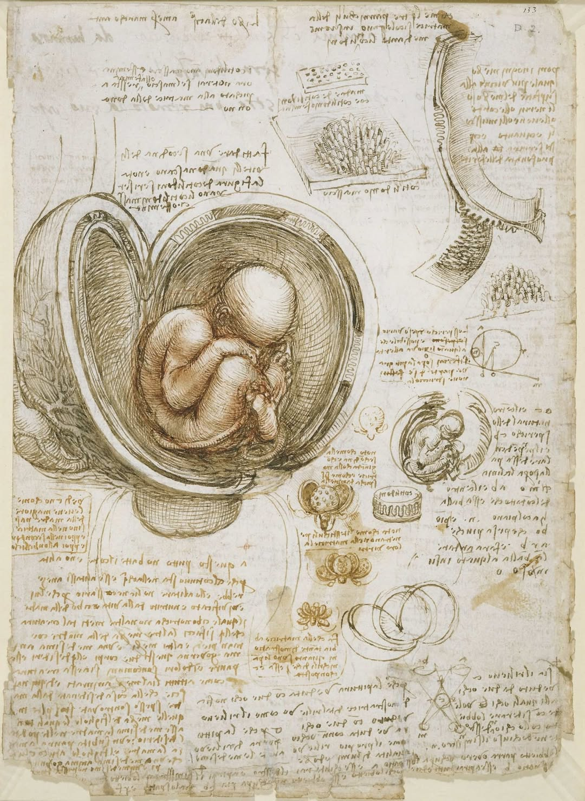

How badly adapted we are life on Earth ?

English version: [HOW BADLY ADAPTED WE ARE TO LIFE ON EARTH - The School Of Life Blog](https://www.theschooloflife.com/article/how-badly-adapted-we-are-to-life-on-earth/)

Source dịch (Vietnamese version): [CHÚNG TA ĐÃ TỒN TẠI MỘT CÁCH KHÔNG HOÀN HẢO TRÊN TRÁI ĐẤT NHƯ THẾ NÀO  - Tâm lý học tội phạm Fanpage](https://www.facebook.com/share/p/1VRcbQxdc6/)

### 🌼 CHÚNG TA ĐÃ TỒN TẠI MỘT CÁCH KHÔNG HOÀN HẢO TRÊN TRÁI ĐẤT NHƯ THẾ NÀO

Chúng ta thường ca ngợi trí óc và cơ thể con người: từ nhiều góc độ, chúng thực sự là những kiệt tác của kỹ thuật. Bộ não của chúng ta có thể giải những phương trình fractal, dịch từ tiếng Phần Lan sang tiếng Bengal, hoặc biểu diễn La Traviata – trong khi cơ thể có thể chinh phục đỉnh Matterhorn, đánh quả bóng bay qua lưới với vận tốc 263 km/h, và tạo ra sự sống mới kéo dài cả một thế kỷ.

Tuy nhiên, dù xuất sắc đến thế nào, chúng ta cũng cần thành thật thừa nhận rằng mình được thiết kế không hẳn hoàn hảo. Điều này không chỉ để giảm bớt sự khắc nghiệt mà ta thường dành cho bản thân, mà còn giúp ta hiểu rằng sự hỗn loạn và nỗi buồn mà ta thường tạo ra không hoàn toàn là lỗi của mình. Những "cỗ máy" mà ta đang cố sống trong đó thực chất đầy những khiếm khuyết.

Chúng ta là kết quả của quá trình tiến hóa – một quá trình đã để lại những “sản phẩm” không mấy phù hợp với nhiều nhiệm vụ mà chúng ta phải đảm đương. Cơ thể của chúng ta chứa đầy những bộ phận thừa thãi hoặc đã trở nên vô dụng. Chúng ta chẳng cần gì đến cái xương cụt – phần cuối của cột sống, vốn là tàn dư của chiếc đuôi, giờ chỉ gây đau lưng và khó chịu khi lớn lên. Răng khôn, đầu vú của nam giới hay ruột thừa cũng hoàn toàn không có tác dụng gì.

Những vấn đề tương tự cũng tồn tại trong tâm trí. Nỗi đau khổ mà chúng ta chịu đựng chính là hệ quả của bộ não vô cùng phức tạp và nhạy cảm – một bộ máy có khả năng tính toán vận tốc của sao Thổ hoặc cảm nhận sắc thái tinh tế nhất trong một bản sonata cung đô trưởng – nhưng lại phải vật lộn với những thực tế vụn vặt và tẻ nhạt của cuộc sống. Chúng ta là những con vượn được “lắp ráp” quá mức cần thiết, chứa đầy năng lượng thần kinh bất định, không định hướng. Vì vậy, không có gì lạ khi phần lớn chúng ta thường xuyên mất ngủ.

Hãy liệt kê thêm những vấn đề khác:

– Quá khứ của chúng ta là một “mạng lưới” rối rắm khó tháo gỡ. Bộ não con người được “lập trình” để quá nhạy cảm với những tổn thương từ tuổi thơ, đến mức nhiều người vẫn còn vật lộn với chúng ngay cả khi đã già.

– Chúng ta thường khắc nghiệt với chính mình một cách vô ích và đầy tàn nhẫn. Kỳ lạ thay, ta lại đối xử tử tế hơn với những kẻ thù của mình so với cách ta đối đãi bản thân. Điều này phần lớn bắt nguồn từ việc ta đã vô thức tiếp thu những cách tự phán xét khắt khe, được hình thành từ những người từng là những “quan tòa” nghiệt ngã nhất trong quá khứ bướng bỉnh và đau thương của chính ta.

– Chúng ta thật kém cỏi trong việc suy nghĩ. Chúng ta dễ dàng hoảng loạn, né tránh những suy nghĩ quan trọng, khao khát tìm kiếm sự phân tâm và thường tự hiểu bản thân một cách lúng túng, sai lệch. Ta gặp khó khăn kinh khủng trong việc tìm ra công việc phù hợp, khai thác những tiềm năng tốt nhất của mình và thực sự thấu hiểu những gì đang điều khiển nội tâm ta.

– Chúng ta quá dễ bị hù dọa bởi những mối đe dọa không đáng, trong khi lại phớt lờ những thứ thực sự cần quan tâm. Đặc biệt, ta thường không trân trọng những gì mình đang có khi còn thời gian. Chúng ta không thể đánh giá đúng các nguy cơ thực sự hoặc nhận ra giá trị bị đánh đổi bởi những lựa chọn sai lầm. Ta luôn lo lắng về việc lãng phí tiền bạc nhiều hơn là lãng phí thời gian.

– Ta bận tâm quá mức đến những gì người khác nghĩ về mình. Chúng ta hành xử như thể vẫn sống trong những bộ lạc nhỏ, nơi từng lời đồn thổi có thể là chuyện sống còn. Và thế là ta dành hàng năm trời để cải thiện hình ảnh bản thân trong mắt những người xa lạ – những người chẳng hề quan tâm đến ta dù chỉ một chút.

– Chúng ta phóng đại quá mức khả năng đạt được hạnh phúc của mình – và vì thế, phải chịu đựng nỗi thất vọng cay đắng khi hy vọng tan vỡ. Ta không thể thanh thản chấp nhận rằng khả năng cao là mình sẽ không giàu có hay có được cuộc hôn nhân hạnh phúc. Ta gào lên trách móc sự bất công của số phận, dù thực chất đó chỉ là lẽ thường của cuộc đời.

– Chúng ta là những sinh vật dễ nghiện, bị chi phối bởi những cám dỗ ngắn hạn, đặc biệt là với đồ ăn, rượu bia, nội dung khiêu dâm và thói quen nằm dài trên ghế sofa.

– Chúng ta nghĩ về tình dục quá nhiều, vượt xa những cơ hội thực tế hay các ưu tiên quan trọng khác.

– Và cuối cùng, chúng ta luôn thiên về cảm giác bất hạnh. Cơ thể và tâm trí của chúng ta không mấy quan tâm đến việc giúp ta cảm thấy hài lòng. Có lẽ trong buổi đầu tiến hóa, lo lắng và nhạy cảm trước nguy hiểm đã mang lại lợi thế sinh tồn – những kẻ vô lo đều đã bị hổ ăn thịt. Chiếc "máy" mà chúng ta sống trong đó sẽ chọn khiến ta lo lắng 99% thời gian hơn là để ta thư giãn và trở thành con mồi. Vì vậy, ta để những ngày đẹp nhất lặng lẽ trôi qua mà không hề trân trọng. Và vì thế, cụm từ “sống trọn từng khoảnh khắc” trở thành điều thật nực cười, thậm chí vô tình tàn nhẫn.

Để đối phó với cơ thể đầy khiếm khuyết của mình, chúng ta đã phát minh ra y học, dinh dưỡng và các bài tập thể dục. Để giải quyết tâm trí đầy vấn đề không kém, chúng ta cần dựa vào triết học, liệu pháp tâm lý và khoa học tâm lý với cùng mức độ tin cậy.