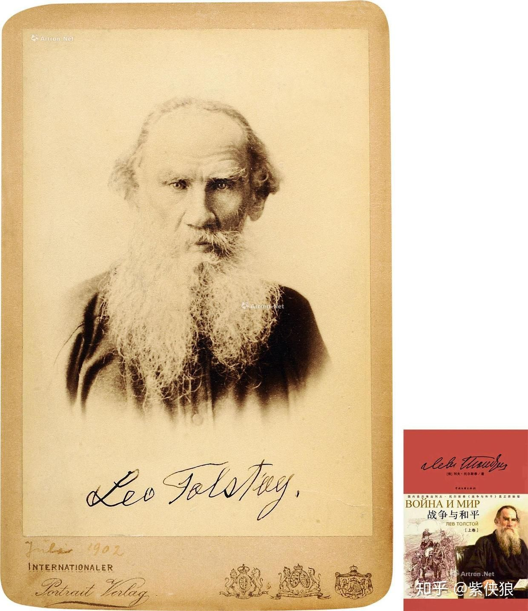

Mọi loại tình cảm trên đời này, thật ra đều là “Hiệu ứng Franklin".

Nguồn: [BẢN CHẤT CỦA VIỆC YÊU THÍCH MỘT NGƯỜI LÀ GÌ? - Tâm lý học tội phạm Fanpage](https://www.facebook.com/share/p/1B2M2jqF7i/)

## 🌹 1. Đầu tiên phải kể đến một câu chuyện nổi tiếng:

Giai đoạn chiến tranh thế giới thứ 2, người Do Thái bị quốc xã Đức đàn áp. Hai người anh em Do Thái đã thảo luận về việc nhờ ai giúp đỡ và ý kiến của bọn họ không giống nhau. Người em trai muốn yêu cầu ngân hàng mà bố của họ đã từng tài trợ giúp đỡ, và ngân hàng ấy cũng đã rất nhiều lần bày tỏ sẽ báo ơn nếu có cơ hội. Người anh lại nhận định rằng, nên tìm sự giúp đỡ của một người thương gia đã từng tài trợ tiền cho gia đình họ khi mới bắt đầu kinh doanh. Không ai chấp nhận ý kiến của ai, vì vậy họ chia nhau ra làm theo ý bản thân và mất liên lạc. Nhiều năm sau, người anh trai – nhận được sự giúp đỡ của thương nhân buôn gỗ trốn đến Nhật Bản, quay về nước tìm em trai mình, phát hiện em trai đã chết ở Auschwitz. Sau đó, người anh đã tìm thấy trong kho lưu trữ của quốc xã Đức về hồ sơ điện thoại báo nơi ẩn náu của em trai mình mà người gọi chính là nhân viên ngân hàng.

Người anh thở dài: “Người đã từng giúp đỡ bạn, đáng tin cậy hơn người bạn từng giúp đỡ."

## 🌹 2. Có một ví dụ cực kì điển hình trong Marketing hiện đại.
Thế kỉ trước, có một nhân viên công ty máy hút bụi ở Mỹ được mệnh danh “quán quân ngành Marketing".

Trước khi nghỉ hưu, ông nói với tất cả nhân viên khác: “Mấy đứa thật là ngu ngốc, mời gọi mua hàng chỉ biết gõ cửa hỏi: "Chào bà, có thể cho tôi 3 phút để giới thiệu về sản phẩm của công ty chúng tôi không?" Mỗi lần nói xong, “rầm" một tiếng đóng cửa ngay trước mặt. Mấy đứa nói đây không phải là quấy rối thì là gì? Khách hàng không báo cảnh sát là đã khách khí lắm rồi." Thế rồi các nhân viên hiếu kỳ hỏi ông: "Thế ông làm cách nào để giới thiệu sản phẩm cho khách hàng?". Vị nhân viên già sắp về hưu liền trả lời: "Tôi sẽ nói, chào bà, tôi là một người bán hàng đi ngang qua đây, khát nước quá. Bà có thể cho tôi xin một cốc nước được không?" Sau đó, tôi có thể vào trong nhà khách hàng và quan sát xung quanh. Rồi trong lúc khách hàng đi rót nước, nói qua loa về chuyện gia đình, rồi nói vài lời về “máy hút bụi" mà tôi quảng bá. Khách hàng không có áp lực, tất nhiên sẽ tiếp lời của tôi rồi. Cứ như thế, tỉ lệ giới thiệu sản phẩm thành công có thể tăng đến 60%. Các nhân viên khác nghe đến đây như tỉnh mộng, vỗ tay khen ngợi vị nhân viên già.

Trong thực tế, trường hợp này có một thuật ngữ tâm lý gọi là “Hiệu ứng Franklin."

Hiệu ứng này dựa theo một câu nói của Benjamin Franklin – một trong những người thành lập ra nước Mỹ vào thế kỉ 18.

Franklin từng nói: “So với người đã được bạn giúp đỡ, những người đã giúp đỡ bạn sẽ sẵn sàng giúp đỡ bạn một lần nữa." Tại sao ông lại nói vậy? Bởi vì ông đã từng làm một chuyện ảnh hưởng đến tâm lý học thế giới. Câu chuyện như sau:

Năm 1736, một ngày nọ, Franklin đã có bài phát biểu ở Pennsylvania. Một nghị sĩ khác hoàn toàn phản đối quan điểm của ông, đồng thời phát biểu một bài khác, chỉ trích Franklin rất quyết liệt. Franklin có phần trở tay không kịp, nhưng lại mong giành được sự đồng ý của vị nghị sĩ này. Nên làm sao đây?

Trong lúc vô tình ông biết được trong nhà của nghị sĩ này có một bộ sách rất hiếm. Vì vậy, ông đã viết một bức thư rất trân trọng mong được mượn bộ sách này. Thật bất ngờ, vị nghị sĩ này đã đồng ý. Sau một thời gian, Franklin đã long trọng bày tỏ lòng biết ơn của mình khi trả lại bộ sách. Khi họ gặp nhau ở hội trường Quốc hội vài ngày sau đó, Franklin đã nói rằng: “Ông ấy thậm chí còn chủ động chào hỏi tôi (chuyện chưa từng có trước đây), và sau khi chúng tôi trò chuyện, ông ấy còn bày tỏ, bất cứ lúc nào cũng có thể vì tôi mà góp sức." Từ đó hai người chuyển thù thành bạn, duy trì tình hữu nghị suốt đời.

Vì vậy, các nhà tâm lý học của các thế hệ sau đưa ra kết luận:"Cách tốt nhất để khiến người khác thích bạn không phải là giúp đỡ họ, mà là để họ giúp đỡ bạn."

Đây là nguồn gốc của "hiệu ứng Franklin" nổi tiếng.

## 🌹 3. Một thế kỷ sau, Lincoln, một tổng thống Mỹ khác, đã được truyền cảm hứng sâu sắc bởi “hiệu ứng Franklin".

Vào dịp nọ, Lincoln nhờ đối thủ chính trị làm một việc nhỏ. Một nghị sĩ chỉ trích: “Tại sao lại cố gắng làm bạn với kẻ thù? Không phải nên loại bỏ hắn sao?" Lincoln nhẹ nhàng trả lời: “Không phải tôi đã tiêu diệt kẻ thù của mình rồi sao? Đặc biệt là khi chúng tôi còn trở thành bạn bè." Nhờ một người thù ghét mình giúp một việc nhỏ, có thể biến thù thành bạn, biến vũ khí thành tơ lụa. Biện pháp này có tin được không? Có thể xảy ra không?

## 🌹 4. Năm 1969, nhà tâm lý học Joan Jack và David Randy đã quyết định trực tiếp kiểm tra xem “hiệu ứng Franklin" 200 năm tuổi đã hết hạn sử dụng trong thế kỉ 20 hay chưa.

Họ sắp xếp một cuộc thi kiến thức và để tất cả người tham gia giành được một khoản tiền nhỏ. Sau cuộc thi, nhà nghiên cứu đã nói với 1/3 người tham gia: “Ông ấy tổ chức cuộc thi bằng tiền riêng của mình, bây giờ ông ấy hết sạch tiền rồi, mọi người có thể trả lại tiền cho ông ấy không?" Một thư ký nói với 1/3 số người tham gia khác: “Đây là một cuộc thi được tài trợ bởi phòng thí nghiệm, hiện tại vốn của phòng thí nghiệm không còn nhiều, có thể mong mọi người trả lại tiền cho phòng thí nghiệm được không?"

Sau cuộc thí nghiệm, tất cả người tham gia đều phải điền một tờ khảo sát, đưa cho nhà nghiên cứu và thư ký chấm điểm. Kết quả của cuộc thí nghiệm chứng minh rằng:

- Nhà nghiên cứu được cho điểm cao hơn nhiều so với người thư ký.

- Người tình nguyện trả tiền lại có số điểm cao hơn nhiều so với những người không đồng ý trả tiền lại.

Cũng có thể nói, “hiệu ứng Franklin" vẫn còn đủ tiêu chuẩn và giữ được chất lượng của nó.

## 🌹 5. Đại văn hào Tolstoy cũng đồng ý với hiệu ứng này.

Ông từng viết trong cuốn “Chiến tranh và Hòa bình":

"Chúng ta không yêu họ vì họ tốt với ta, mà vì ta yêu họ nên ta đối tốt với họ."

Mà cái “tốt" trong câu của Tolstoy thực chất chính là trao sự giúp đỡ.

Bởi vì người thương nhân đã cho gia đình Do Thái một khoản tiền để giúp đỡ họ, nên sinh ra hảo cảm, vẫn bất chấp nguy hiểm giúp đỡ lần nữa.

Bởi vì khách hàng cho người bán hàng một cốc nước, nên sinh ra hảo cảm, tiếp nhận việc chào hàng.

Bởi vì người nghị sĩ cho Franklin mượn bộ sách quý, nên sinh ra hảo cảm, nguyện cởi bỏ thù hận.

Cũng bởi như vậy, những người tham gia cuộc thi kiến thức mới thích nhà nghiên cứu tự bỏ tiền ra hơn là thư ký chi tiền cho công ty. Thực tế hơn, hiệu ứng này còn liên quan đến một hiện tượng tâm lý khác:

Khi bạn giúp đỡ một người, ngay cả khi không thích đối phương, đại não của bạn sẽ tự động điều chỉnh nhận thức, nói với bạn rằng đối phương là người đáng để giúp đỡ, trong lòng bạn sẽ càng hình thành nên một loại “phụ thuộc tuyến" (Path dependence). Khi đối phương xin trợ giúp lần hai, bạn sẽ càng vui vẻ giúp đỡ, sẽ càng thích đối phương hơn. Nhà kinh tế học nổi tiếng người Mỹ - Douglas North, người dựa vào định luật “Franklin" phát hiện định luật quán tính (law of inertia) của con người, giải thích thành công sự phát triển của hệ thống kinh tế và giành Nobel về kinh tế năm 1993.

Nhưng tại sao bản chất con người lại như vậy?

## 🌹 6. Chúng ta có thể thử tìm hiểu về câu chuyện “Hoàng tử bé" của nhà văn Pháp Exupery:

“Hoàng tử bé sống trên một hành tinh nhỏ, và một ngày nọ, một bông hồng xinh đẹp nở rộ lên trên hành tinh này. Hoàng tử bé chưa bao giờ nhìn thấy một bông hồng đẹp như vậy, vì thế mỗi ngày cậu đều chăm sóc và bảo vệ bông hoa ấy. Cậu nghĩ đó là bông hoa hồng duy nhất trong vũ trụ, đẹp hơn tất cả các loài hoa. Rồi một ngày nọ, cậu đến trái đất và thấy rằng có 5000 bông hồng gần như giống hệt nhau trong một khu vườn. Ngay lúc đó cậu cuối cùng cũng biết rằng tất cả những gì cậu có là một bông hoa bình thường. Phát hiện này khiến Hoàng tử bé rất buồn. Nhưng mặc dù vậy, không biết tại sao, cậu vẫn không thể bỏ xuống bông hoa hồng của mình. Cho đến tận một ngày một con hồ ly nói với cậu :"Bởi vì cậu bỏ thời gian và tâm huyết của mình đi chăm sóc bông hoa ấy, mới làm cho bông hoa của cậu trở nên đẹp hơn." Hoàng tử bé chợt nhận ra, dù trên thế giới có vô số bông hoa hồng, nhưng bông hoa ở trên hành tinh của cậu ấy là độc nhất vô nhị. Bởi vì cậu từng tưới nước cho nó, từng bảo vệ nó, nói chuyện với nó, cùng nó yên lặng,… Thế nên nó là bông hoa độc nhất vô nhị trong cậu.

Cũng như vậy, con người trên trái đất, nhiều hơn sao trên trời, cũng nhiều hơn cát bụi trên sông Hằng. Thử hỏi, có người nào trong chúng ta không phải một người thường trong trăm nghìn đồng loại? Có người nào chúng ta yêu không bình thường như một bông hoa trong trăm nghìn đóa? Bông hoa trong tay chúng ta có thể nổi bật như vậy, chẳng phải vì bông hoa ấy vốn dĩ nổi bật, mà vì chúng ta đặt hết tất cả ánh nhìn vào bông hoa ấy. Người mà chúng ta đặt trong tim, một nụ cười khuynh thành, chẳng phải vì bản thân họ có bao nhiêu mị lực, mà bởi chúng ta đặt tất cả tình cảm bản thân vào đối phương.

## 🌹 7. Vậy tại sao người đơn phương lúc nào cũng rối loạn, người được chiều chuộng lại chẳng sợ được mất? Bởi người trước luôn luôn bỏ ra, còn người sau lại gần như không có.

Tại sao cha mẹ luôn luôn lo lắng cho con cái, mà đứa con bất hiếu lại chẳng hề quan tâm? Bởi cha mẹ không ngừng cho đi, mà con cái lại gần như chẳng phải trả giá.

Tại sao đứa con ngoan luôn bị bỏ bê, đứa con hư lại được quan tâm lo lắng? Bởi đứa con hư đòi hỏi cha mẹ phải chú ý, phải bỏ ra nhiều hơn. Đứa con ngoan làm cha mẹ yên tâm, cũng bớt đi một phần lo lắng.

Tại sao tình thương của mẹ thường lớn hơn tình thương của cha? Bởi người mẹ mang thai gần mười tháng, trăm khó ngàn nguy, bỏ ra cho con cái nhiều hơn người cha.

Hiệu ứng này đều được áp dụng ở nơi làm việc, trong tình bạn hoặc các lĩnh vực khác. Cái gọi là “con khóc mẹ mới cho bú", “mối quan hệ đều từ phiền phức tạo thành" … đều là những quy tắc vàng được sinh ra bởi hiệu ứng này. Do đó, chúng ta yêu một người vì chúng ta cho đi. Nếu không có sự cho đi thì sẽ không có tình yêu. Nói một cách nghiêm túc, thế giới này không có cái gọi là “yêu từ cái nhìn đầu tiên".

Nếu có một người nói với bạn anh ta chỉ mất vài giây để yêu một cô gái. Bạn chỉ cần hỏi anh ấy một câu: “Chỉ trong vài giây, anh có nguyện ý vì cô ấy mà hi sinh tính mạng không?" Anh ta chắc chắn không đồng ý, cũng như chúng ta rất ít người đồng ý vì một thần tượng mà từ bỏ mạng sống bản thân. Bởi vì ngắn ngủi vài giây, không thể nào yêu được một người. Đương nhiên, nam hay nữ cũng vậy.

## 🌹 8. Vậy anh ta làm sao để có tình cảm với một người? Tình hình như sau:

Sau khi gặp mặt, anh ta ngày nhớ đêm mong, ăn uống đều nhớ đến, mọi thời khắc đều nghĩ đến, thậm chí trong mơ cũng không thoát được. Thế nên một ngày của anh ta ngoại trừ đi ngủ, có thể nhớ một người đến 16 tiếng. Mà một người con trai khác cũng thích cô gái ấy, mỗi ngày có thể chỉ nhớ đến cô ấy trong 1 tiếng. Chúng ta ví dụ yêu một người cần nhớ đến đối phương 160 tiếng, vậy người con trai đầu tiên chỉ cần đến 10 ngày, trong khi người thứ 2 cần đến 160 ngày. Đây là chân tướng của “vừa gặp đã yêu". Nó thể hiện rằng 2 người lần đầu gặp đã có chút cảm giác với đối phương, nhưng vẫn cần thời gian mới có thể sinh tình. Trong một khoảng thời gian nhất định, nếu cả hai đều cho đi, gọi là tình yêu, nếu chỉ có một bên cho đi, gọi là đơn phương, mà cả hai bên đều không muốn cho đi, cùng lắm chỉ có thể gọi là bạn bè. Thế nên, nếu không có đủ thời gian cho đi, đừng nói vài giây, có khi quen biết cả đời cũng không thể gọi là yêu.

## 🌹 9. Nhớ nhung, là sự cho đi của một người trong tình cảm. Tất nhiên cho đi cũng có nhiều loại: thời gian, tiền bạc, bầu bạn, tinh thần …

Nhưng suy cho cùng, tất cả các loại cho đi đều theo thời gian quy về một mối, cuối cùng biến thành vì tình cảm mà cho đi. Bởi vì đoạn thời gian mà chúng ta cho đi ấy, trở thành những hồi ức tốt đẹp, hòa vào máu của chúng ta, biến thành một phần trong sinh mạng của chúng ta.

Trước đây có một người con gái hỏi cha mình, làm sao để khiến chàng trai cô ấy thích động lòng? Cha cô ấy trả lời:"Để khiến anh ta mua cho con một cây kem." “Sau đó thì sao?" “Để anh ta mua thêm một cây nữa."

Tất nhiên, câu chuyện này chỉ là một loại lý luận, tình huống cụ thể cần có cách ứng phó cụ thể, mỗi một kiểu người cần sử dụng các mẹo khác nhau, tùy bệnh mà kê đơn thuốc. Tổng kết lại, phương pháp tốt nhất chỉ có một câu :"Trong lúc bạn bỏ ra, cũng phải dẫn dắt đối phương bỏ ra vì bạn." Người cha trong câu chuyện trên là một bậc thầy về bản chất con người, cũng rất thành thạo “hiệu ứng Franklin". Bởi vì việc mua kem nhìn thì có vẻ rất đơn giản, nhưng lại cần sự cho đi một cách tinh tế.

Anh ta sẽ nghĩ, cô ấy thích ăn kem gì? Dâu hay sữa? To hay nhỏ? Ở tiệm này hay ở tiệm kia? Trong vô thức, chàng trai đã bỏ ra thời gian, tiền bạc và tinh thần cho cô gái ấy. Dần dần, người con trai sẽ hỏi bản thân, tại sao phải mua kem cho cô ấy chứ? Bởi vì cô ấy đáng yêu, cô ấy hiểu chuyện, tiếng cười của cô ấy thật ngọt,… Dù cho người ngoài nhìn vào chẳng thấy cô ấy có gì đặc biệt, nhưng chúng ta cũng có thể yên tâm rồi. Bởi vì bằng mọi cách, anh chàng ấy sẽ tự tìm 100 lý do thuyết phục bản thân. Có thể bạn sẽ hỏi, tại sao các bạn nam lại ngốc nghếch đến vậy? Tôi chỉ có thể trả lời, không phải chỉ các bạn nam, mà con người ai cũng đều như vậy. Không sai, đây lại là một phản ứng tâm lý học gọi là “Bất hòa nhận thức" (Cognitive Dissonance). Đơn giản như thế này:

Khi con người phát hiện khách quan và hiện thực mà bản thân nhận thức có sự bất đồng thì sẽ tạo ra một loại cảm giác không phối hợp, không thoải mái. Thừa nhận sai sót là làm trái với bản năng con người, trên thế giới từ trước đến nay chẳng mấy ai có thể làm được. Thanh minh một chút: Nhận sai ở đây là từ nội tâm nhận định rằng logic của bản thân là sai, chứ không phải cái năng lực ngoài mặt miễn cưỡng nhận sai.

## 🌹 10. Vậy bây giờ, quay về vấn đề cũ:

Anh chàng này đầu tiên rơi vào cái bẫy “hiệu ứng Franklin", sau đó hình thành thói quen “phụ thuộc tuyến", sau đó lại đạp phải cái bẫy của “bất hòa nhận thức", cuối cùng còn có “chi phí chìm - sunk cost" (một loại chi phí đã xảy ra không thể nào thay đổi) lượn lờ trước mắt anh ta, bạn cảm thấy anh ta sẽ dễ dàng bỏ qua người con gái mà ngày nào anh ta cũng mua kem cho không? Gần như không thể. Trừ khi xảy ra trạng thái bất thường không thể dự tính trước. Ngược lại, bạn nam sẽ vì những gì mình bỏ ra mà dần dần cảm thấy bạn nữ “thoát tục", “không giống người thường". Tích trữ qua ngày tháng, anh ta sẽ yêu cô gái ấy trong vô thức. Tình yêu, thực ra chỉ đơn giản như vậy.

Cái gọi là tình yêu, chính là tất cả những thứ mà bạn nguyện dâng tặng đối phương.